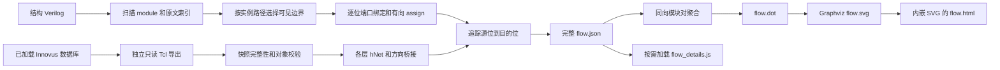

# 连接图如何生成

## 两种输入，共用绘图

## 层次选择

分析根限定范围，默认相对 depth 控制所有分支，实例级展开覆盖对应子树的默认预算。为了到达指定展开实例，可以打开其祖先；遇到 stop 保持折叠。对同 module 类型的不同实例，使用完整路径隔离网络，不能用类型名共享实例连接。

根端口集中表现为 `$PORT` 节点。可见折叠模块用其边界端口参与连通；打开某实例后，改为内部可见模块，并沿真实父子端口绑定接到外部。

## 方向和计数

源为根输入或可见模块输出，目的为根输出或可见模块输入。父子 input 桥方向是父层到子层，output 桥方向相反。Verilog 简单 assign 建立 RHS → LHS 边，不能无向合并造成反向穿越。

对每个源位遍历有向图，到达可见目的位即形成一个配对。同一源位与同一目的位只计一次，防止多条别名路径重复计数。完整位映射保存在 `flow.json`，每个端口对最多保留 8 条路径示例。图形按有向模块对求和，两个方向分别画边，反馈保留。

计数不是 net 数：一个源位扇出到 3 个可见输入位贡献 3 个配对。工具不从折叠模块输入穿越到其输出；因此不能把画出的箭头视为逻辑锥、时序路径或功能数据流。

## Innovus 快照

Tcl 读取 `dbGet` 对象，以 immediate hInst 层次解析路径；不将方括号、点号或星号当作匹配表达式。hInstTerm 的 `term.bus` 决定标量/向量位，名称末尾 `[0]` 本身不代表总线位。

导出六张表：nodes、scopes、ports、bridges、hnets、diagnostics。表头为 TSV，数据字段逐个用 JSON 字符串编码。最后写入带行数、字节数和完成状态的 manifest，再发布结果目录。Python 校验格式版本、引用对象、层次、位信息和文件完整性后才追踪。

使用原始 hNet 及 `upHNet` / `downHNet` 的方向桥接，canonical flat net 仅保留为证据。将所有同 flat net 的 hNet 无向合并可能穿越折叠模块内部 alias，故本实现不采用此捷径。

## 展示与分析分离

`flow.json` 保存分析全集。渲染器按模块对汇总后生成 DOT，调用 Graphviz 得到 SVG，再把同一个 SVG 文本嵌入 HTML。线宽在当前图内按数量的平方根相对缩放到 1–7 pt，标签显示实际数量。

过滤只影响显示集合，不改写完整分析图；页面显示被隐藏的边数和位配对数。首屏不内嵌所有逐位证据，避免大设计的明细膨胀页面。明细侧文件与手动选择的 JSON 均校验所属图的指纹。
